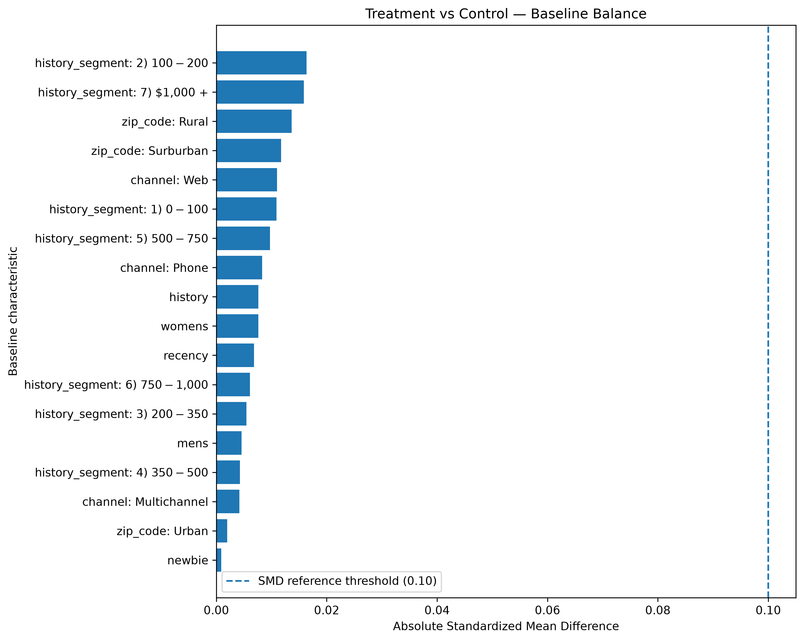
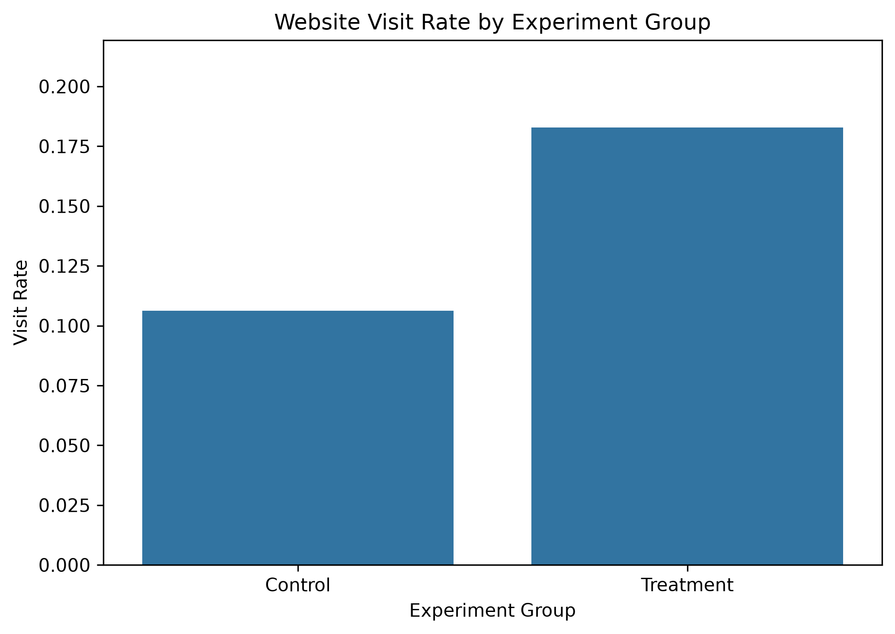
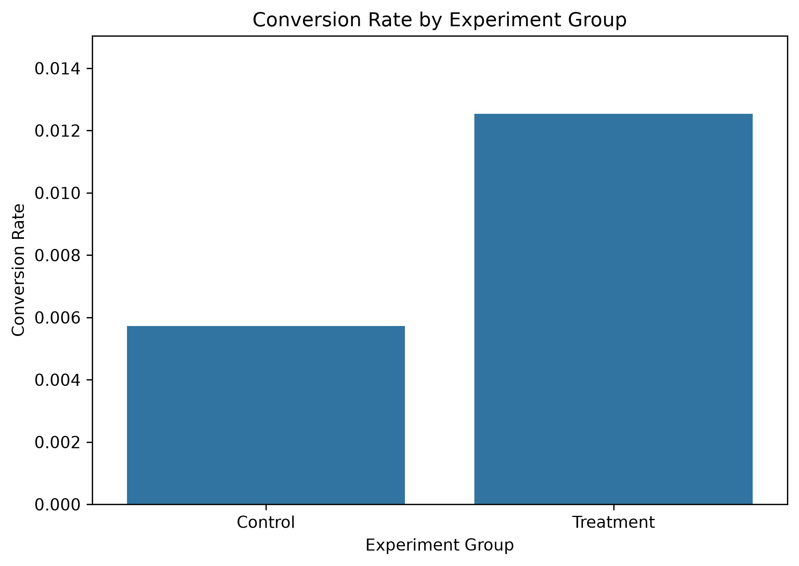
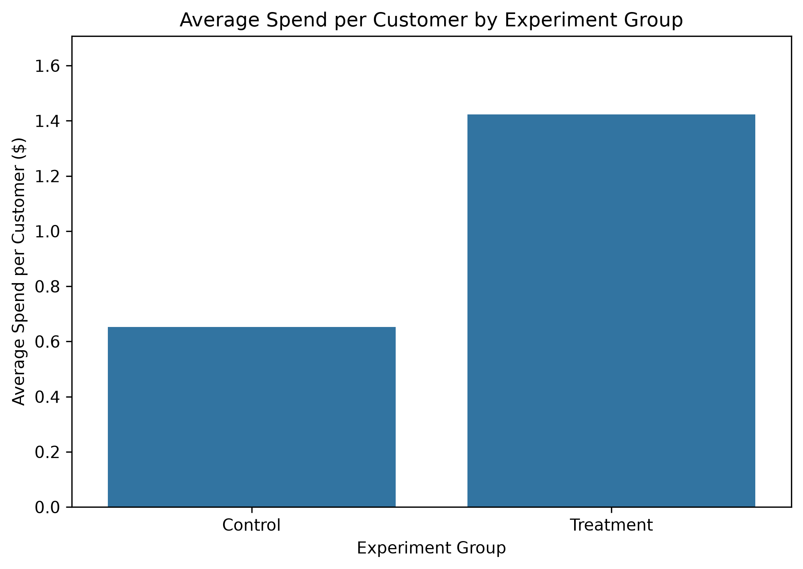

# Exploratory Data Analysis Report
## Marketing Uplift Modeling & Experiment Analysis

### 1. Executive Summary

This analysis examines the Hillstrom Email Marketing Dataset, focusing on the Mens E-Mail treatment group and No E-Mail control group.

The initial binary experiment contains 42,613 customers. The treatment and control groups have nearly identical sample sizes and appear highly comparable across the observed pre-treatment characteristics.

The treatment group has higher observed website visit rates, conversion rates, and average spending per customer.

### 2. Dataset Overview

| Property | Result |
|---|---:|
| Full dataset observations | 64,000 |
| Dataset columns | 12 |
| Binary experiment observations | 42,613 |
| Treatment customers | 21,307 |
| Control customers | 21,306 |
| Missing values | 0 |
| Exact duplicate rows | 6,562 |

The Womens E-Mail group was excluded from the initial binary comparison but retained in the original dataset.

### 3. Baseline Balance

Numeric and binary baseline characteristics were compared using standardized mean differences (SMD).

| Feature | Absolute SMD |
|---|---:|
| Recency | 0.0068 |
| History | 0.0076 |
| Mens | 0.0046 |
| Womens | 0.0076 |
| Newbie | 0.0009 |

Categorical baseline characteristics were also compared.

The largest absolute SMD across all measured characteristics was 0.0164.

All measured characteristics were below the commonly used 0.10 diagnostic threshold.

**Conclusion:** Treatment and control appear highly comparable on the observed pre-treatment characteristics. This supports the planned comparison but does not independently prove random assignment or eliminate unmeasured confounding.

### 4. Campaign Outcomes

| Metric | Control | Treatment |
|---|---:|---:|
| Customers | 21,306 | 21,307 |
| Visit rate | 10.62% | 18.28% |
| Conversion rate | 0.573% | 1.253% |
| Average spend/customer | $0.6528 | $1.4226 |

#### 4.1 Website Visits

The treatment group had a 7.66 percentage-point higher observed visit rate, corresponding to approximately 72.14% relative lift.

#### 4.2 Conversion

The treatment group had a 0.6805 percentage-point higher observed conversion rate, corresponding to approximately 118.84% relative lift.

A two-proportion z-test produced:

- Z-statistic: 7.3851
- P-value: approximately 1.5 × 10⁻¹³
- 95% confidence interval for the treatment-control difference: approximately 0.5014 to 0.8641 percentage points

The observed difference is statistically significant at the 5% level under the test assumptions.

#### 4.3 Average Spending

The treatment group spent an average of $1.4226 per customer, compared with $0.6528 in the control group.

The observed difference was approximately $0.7698 per customer.

A bootstrap procedure with 10,000 iterations and random seed 42 produced a 95% percentile confidence interval of $0.4874 to $1.0614 per customer.

### 5. Data Quality and Limitations

- No missing values were observed.
- 6,562 exact full-row duplicate occurrences were identified. Without customer identifiers, these cannot be confirmed as duplicate customers.
- Duplicate rows were not removed.
- The raw ZIP category spelling `Surburban` was preserved.
- Spending is highly skewed, with a median of zero in both groups.
- The observed outcome differences should not be interpreted as individualized treatment effects.
- Baseline balance on measured features does not independently establish random assignment.

### 6. Key Findings

1. Treatment and control groups have nearly identical sample sizes.
2. Observed pre-treatment characteristics are highly comparable.
3. The treatment group has a higher observed visit rate.
4. The treatment group has a higher observed conversion rate.
5. The conversion-rate difference is statistically significant under the two-proportion test assumptions.
6. Average spending per customer is higher in the treatment group, with a positive bootstrap confidence interval.

### 7. Next Steps

The next stage of the project will focus on uplift modeling.

The objective is to estimate heterogeneous treatment effects rather than simply predict which customers are most likely to purchase.

Potential modeling approaches include:

- Difference-in-means baseline
- T-Learner
- S-Learner
- Uplift evaluation using Qini and AUUC metrics

These approaches will be evaluated only after the experiment design and data assumptions have been reviewed.
